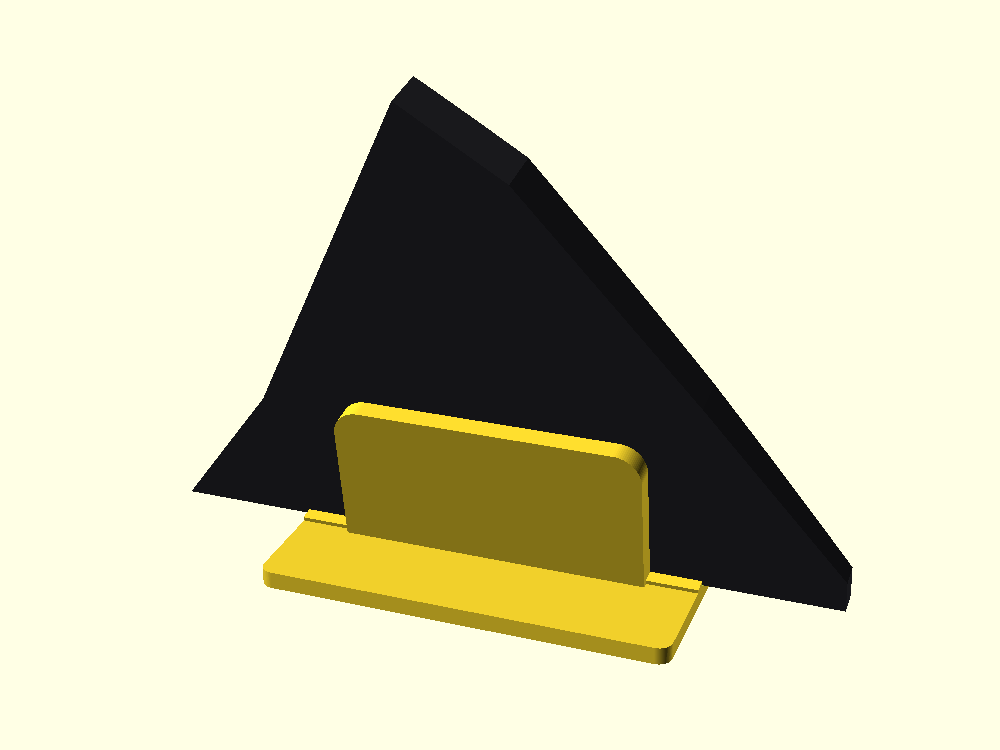
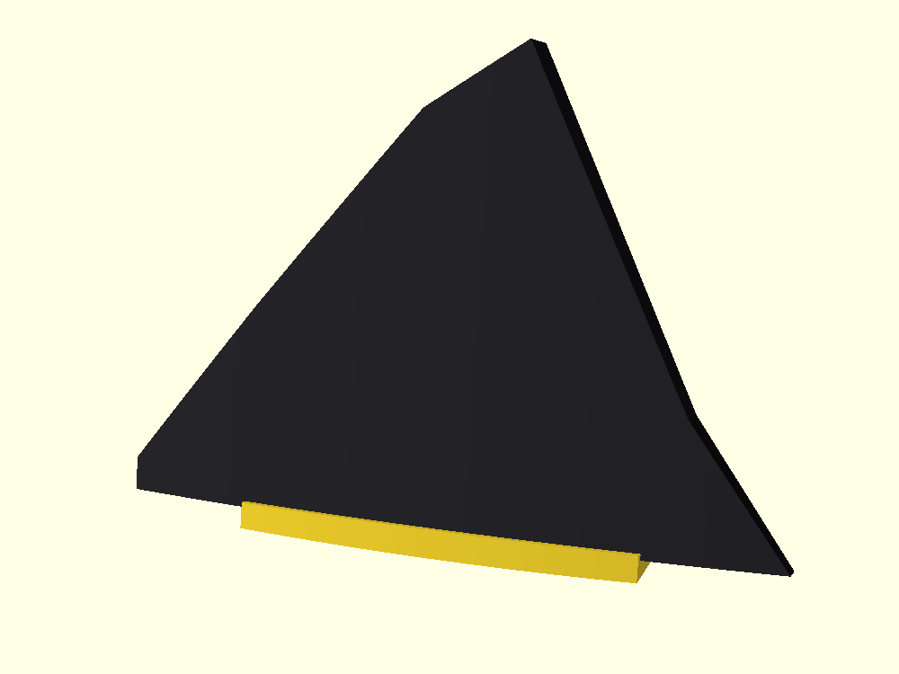
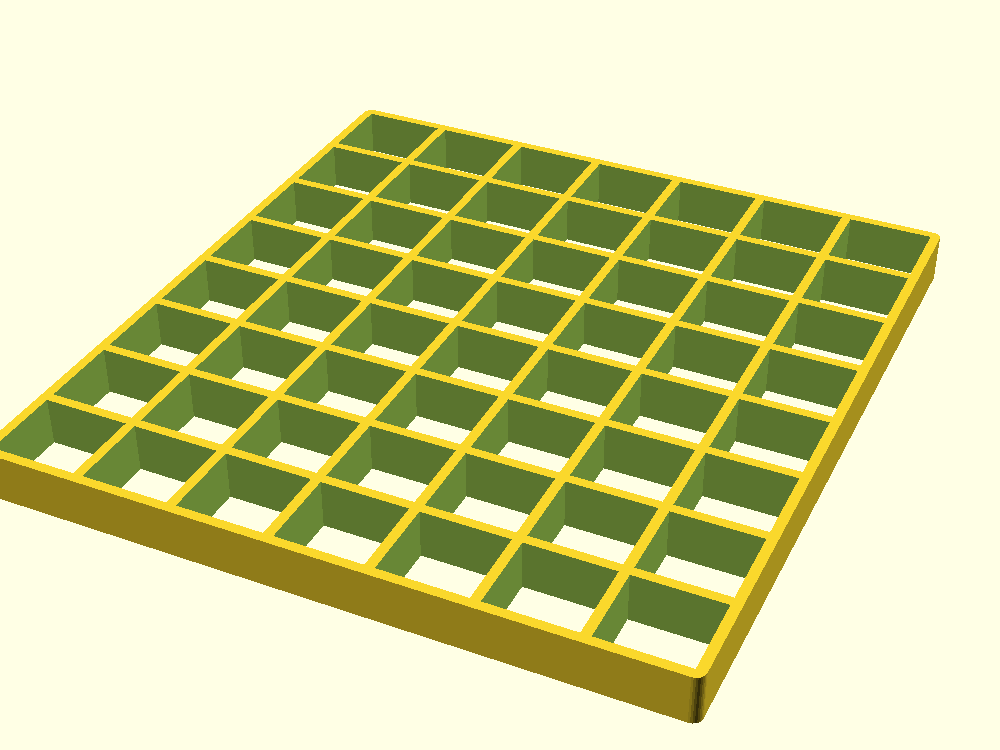
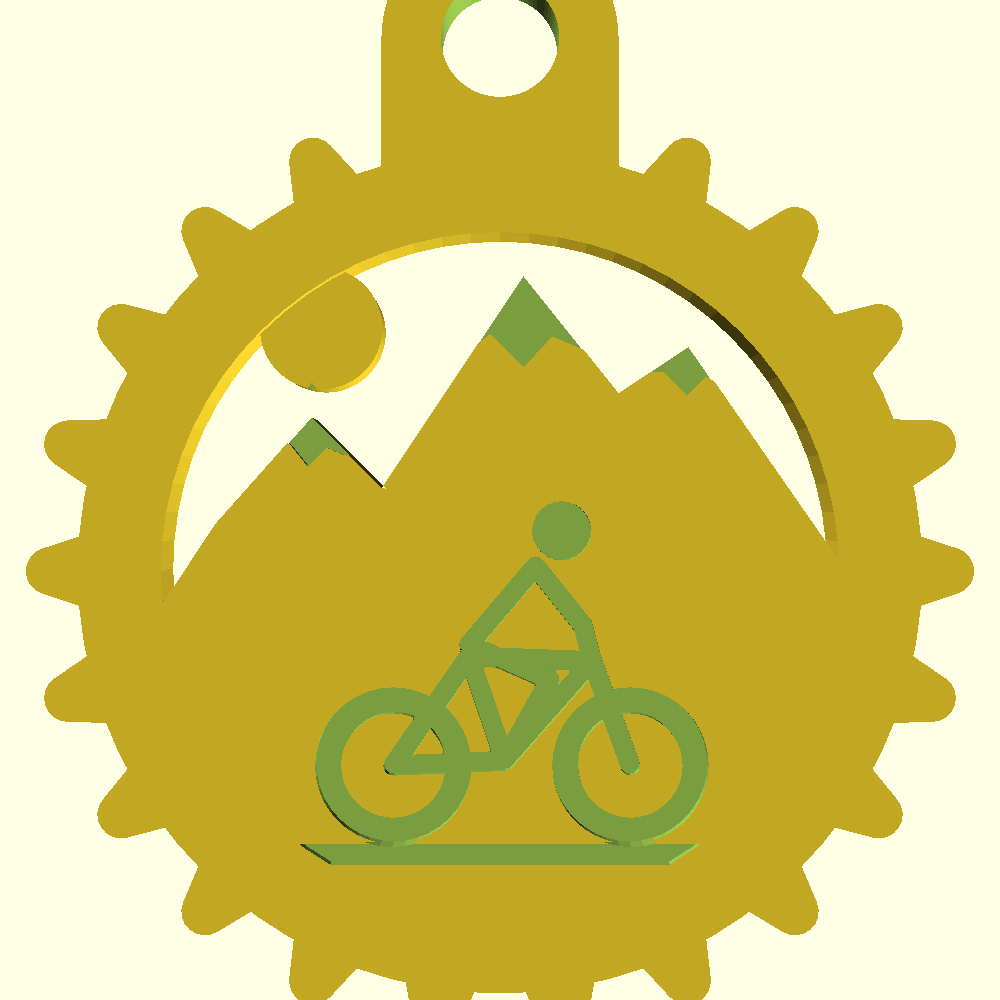
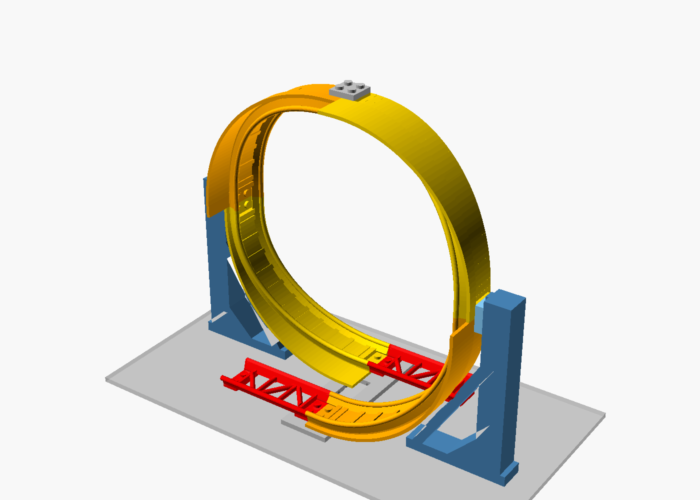
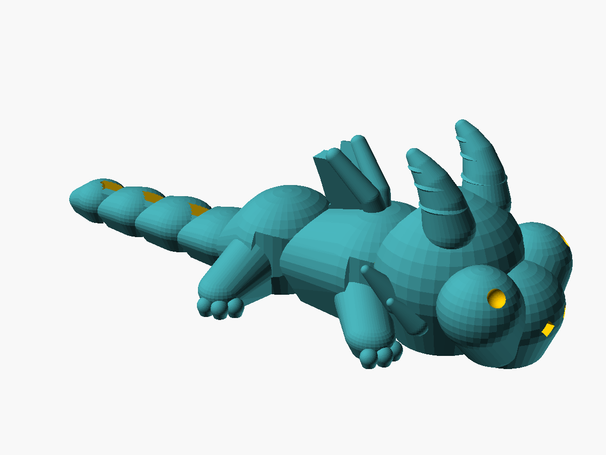
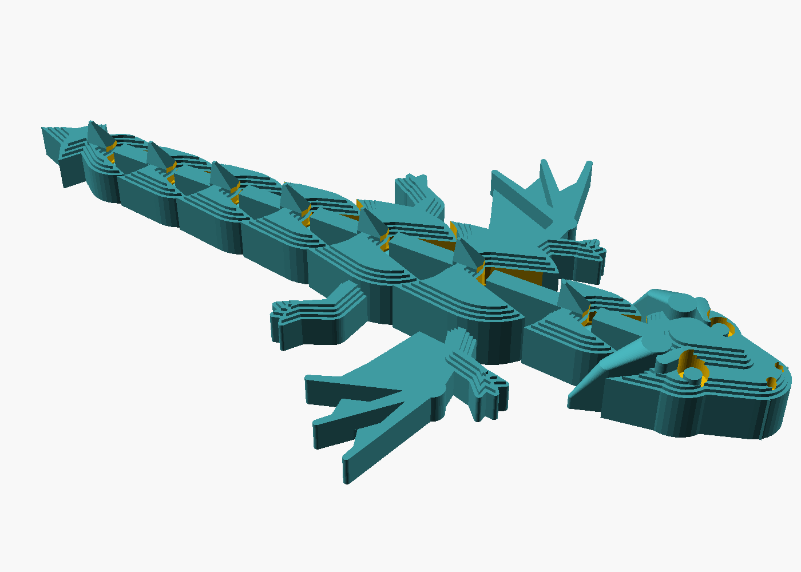
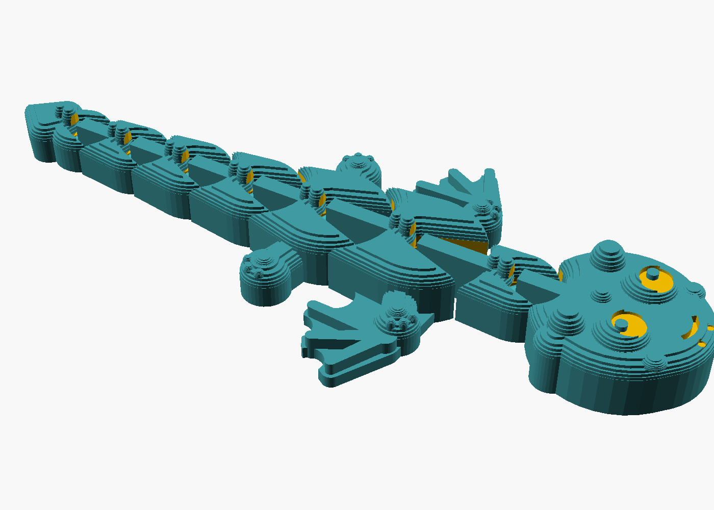

# OpenSCAD — 3D printing projects

## Model Y sliding console organizer

File: `model_y_sliding_console_organizer.scad`

Drop-in organizer for the **front** centre-console bay with the sliding lid on a **Tesla Model Y 2020–2024** (Gen‑2 console, not Juniper / not the under-armrest cubby).

### Holds
| Pocket | Sized for |
|---|---|
| **Card slot** | Credit / e-charge cards (ISO 85.6×54 mm), upright in a ~4 mm throat |
| **Coin dish** | Round bowl (~Ø42 mm) with raised rim + **finger scoop** toward the sunglasses bay |
| **Pen trough** | Pens / pencils along the cup-holder end (~14 mm wide) |
| **Sunglasses bay** | Folded sunglasses in the main open area |

### Layout (top view)
```
 screen end
┌──────────┬─────────────────────────┐
│  cards   │                         │
│          │      sunglasses         │
├──────────┤                         │
│  ◕ coins │                         │
├──────────┴─────────────────────────┤
│           pens                     │
└────────────────────────────────────┘
 cup holders / USB
```

Side **rail lips** let the tray slide; a **cable notch** at the cup-holder end feeds USB from the ports below.

### Default size
| Dim | mm | Notes |
|---|---|---|
| Width | 167 | Gen‑2 trays ≈165; Y often a touch wider |
| Length | 145 | Slightly long so pockets stay reachable under the lid |
| Height | 55 | Leave lid clearance |

Tune `overall_w` / `overall_l` / `overall_h` (and the pocket params) at the top of the `.scad` after measuring your console.

### Print
- **Material:** PETG or ABS/ASA (PLA can soften in a hot cabin)
- **Layer:** 0.2 mm · **Walls:** 3–4 · **Infill:** 20–40%
- **Orientation:** open face up · **Supports:** none

### Export STL
Open in OpenSCAD → **F6** (Render) → **File → Export → Export as STL**.

## Orbital Engine Mk.I

File: `orbital_engine.scad`

Print-in-place **planetary gear fidget** for a FlashForge Adventurer 4 — no glue, no screws. Spin the centre knob; the planet gears orbit the other way. Instant “whoa.”

### Why it’s cool
- Comes off the bed already assembled
- Real epicyclic gear train (sun · planets · ring)
- Sci-fi housing with armour fins and a jewel knob

### Print (Adventurer 4)
| Setting | Value |
|---|---|
| Build volume needed | ~Ø120 mm × ~25 mm tall (bed is 220×200×250) |
| Material | PLA or silk PLA |
| Layer height | 0.2 mm |
| Walls | 3 |
| Infill | 20% |
| Supports | **None** |
| Bed / nozzle | ~55 °C / ~205 °C |

After printing, gently twist the knob back and forth until motion frees up, then spin.

If gears feel tight, increase `backlash` (try `0.55`) and reprint — Adventurer 4s vary a little.


## Gedenkplaat-standaard (Roc du Maroc)

`gedenkplaat/gedenkplaat_standaard.scad` – 120 mm brede standaard voor een plaat van 200 mm breed met een bolle voorkant (15 mm dik in het midden, 7 mm aan de rand, in een boog). De plaat leunt 10° achterover; de gleuf volgt de boog met 0,6 mm speling. De voorste lip is 2 mm hoog zodat de letters (2,5 mm boven de onderrand) zichtbaar blijven.

- Printen: plat op de onderkant, geen support, PLA/PETG, 0,2 mm, 3 wanden, 20% infill.
- Parameters: `speling`, `lip_h`, `hoek`, `rug_h`, `breedte`.



**Minimalistische versie:** `gedenkplaat/gedenkplaat_standaard_minimal.scad` – vooraan enkel een lipje van 2 mm, verder een lage achterwand (25 mm) en twee driehoekige steunpoten die volledig achter de plaat verstopt zitten. Ca. 23 cm³ (≈ 28 g PLA).



## Grid 14 × 15 cm

`grid/grid_14x15.scad` – open grid van 140 × 150 × 10 mm. De verdeling wordt automatisch berekend rond een doelmaat van 20 mm: 7 × 8 vakken (20 × 18,75 mm hart-op-hart, openingen 17,7 × 16,5 mm) met ribben van 2 mm.

- Printen: plat, geen support, PLA/PETG, 0,2 mm.
- Parameters: `doel_vak`, `wand`, `rand`, `dikte`.



## Sleutelhanger: tandwiel met bergen

`sleutelhanger/sleutelhanger_tandwiel_berg.scad` – kettingblad-tandwiel (Ø 40 mm, 22 afgeronde tanden) met bergsilhouet, zon, verdiepte sneeuwkappen en een mountainbiker. Open lucht als doorkijk. 40 × 48 × 4 mm, oog met gat van 5 mm.

- Printen: plat, geen support, 100% infill.
- Tip: pauze op 3,2 mm voor een tweede kleur in sneeuwkappen en mountainbiker.



## LEGO achtbaan-looping

Map: [`lego_looping/`](lego_looping/)

Parametrische verticale **looping voor het LEGO roller-coaster railsysteem** (10261 / 10303 / 31084).
Zelfde principe als de officiële 10303-looping: **4 identieke kwartstukken** met elk 2 noppen zijwaartse
verschuiving, LEGO-compatibele railuiteinden (2 noppen + anti-nop, verbinden met een 2×2 plaat),
plus een base, twee zijframes met schuifpads en een joiner bovenaan als ondersteuning.

- Looping 192 × 192 mm, in- en uitgang 64 mm (8 noppen) naast elkaar
- Elk onderdeel past op de FlashForge Adventurer 4; kwartstukken worden op hun zijkant geprint
- Tolerantie instelbaar (`fit_tol` 0,15 mm standaard) – **print eerst `test_set`** om de pasvorm te checken
- PLA, 0,2 mm, 3–4 wanden, 20–30 % infill, supports alleen vanaf bed onder de onderste rail

Zie [`lego_looping/README.md`](lego_looping/README.md) voor onderdelen, opbouw en risico's.



## Flexi draakje (print-in-place)

Map: [`flexi_draak/`](flexi_draak/)

Beweegbaar **flexi-draakje van 10 cm** (neus tot staartpunt) met vleugels, hoorntjes, oogkassen,
tanden, rugstekels en een pijlvormige staartpunt. Wordt **in één keer plat geprint, zonder supports**.

- 8 losse delen in één print: kop, nek, borst (vleugels + voorpoten), heup (achterpoten) en 4 staartsegmenten
- Scharnieren: verticale pen met verdikking (45° kegels) in een gesloten kom met sleuf, speling `clr` = 0,4 mm;
  elk scharnier draait ca. ±22° zijwaarts
- Parameters: `len_total` (lengte), `clr` (speling), `th` (dikte), `nt` (aantal staartsegmenten)
- **Print eerst `test_joint_v2.stl`**: beweegt het niet los na het printen, verhoog `clr` naar 0,45–0,5
- FlashPrint: PLA, laag 0,2 mm (eerste laag 0,2–0,3 mm), 2 wanden, 15–20 % infill, geen supports, geen raft
  (eventueel brim uit), 200–205 °C, bed 50 °C, eerste laag niet te hard ingedrukt (anders vergroeien de delen)
- Na het printen elk scharnier voorzichtig heen en weer buigen om het los te breken

- **Schattige versie** (kawaii): [`flexi_draak_schattig.scad`](flexi_draak/flexi_draak_schattig.scad) / `flexi_draak_schattig_v2.stl` – grote ronde kop, grote ogen met glimlichtje, glimlach, ronde hoorntjes, bolletjes op de rug, teenkussentjes, ronde vleugeltjes en een hartjesstaart. Zelfde scharnieren en printinstellingen.

- **Versie 3 – 'chubby' 3D-stijl** (geïnspireerd op *Articulated Flexi Cute Dragon* van MiniStudio, eigen geometrie): [`flexi_draak_v3.scad`](flexi_draak/flexi_draak_v3.scad) / `flexi_draak_v3.stl` – grote ronde kop met grote bolle ogen, geribde gebogen hoorntjes, mollig lijf, rechtopstaande vleugeltjes, dikke pootjes met teentjes en een segmentstaart. Rechtop geprint op de buik (ca. 100 × 39 × 32 mm), geen supports, `clr` 0,4 mm. Test eerst `test_joint_v3.stl`. Tip: ogen achteraf zwart stiften.






